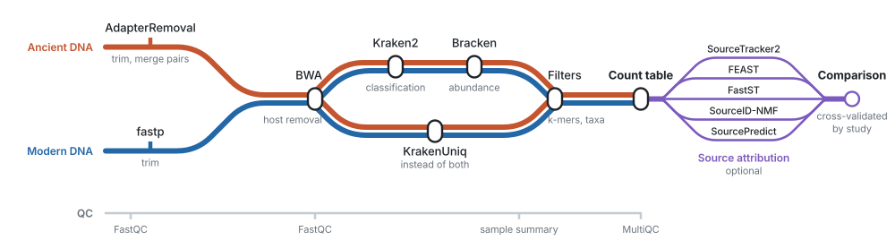

<h1 align="center">MSTFlow</h1>

<p align="center">
Metagenomic profiling of ancient and modern DNA in one analysis,<br>
and source attribution with five methods, plus a test of which one works on your samples.
</p>

<p align="center">
  <a href="https://github.com/larryivan/mstflow/actions/workflows/ci.yml"></a>
  <a href="https://www.nextflow.io"></a>
  <a href="LICENSE"></a>
</p>

<picture>
  <source media="(prefers-color-scheme: dark)" srcset="docs/images/mstflow-workflow-dark.svg">
  
</picture>

## What it does

- **Ancient and modern together.** Each library is trimmed for its kind, then counted and classified the same way against one database. [Tested](docs/validation.md#ancient-and-modern-libraries-in-one-analysis)
- **Source attribution you can check.** SourceTracker2, FEAST, FastST, SourceID-NMF and SourcePredict run on one table and are compared sample by sample. Cross-validation on your own sources shows which to trust. [How it works](docs/attribution.md)
- **Authentication.** The leading taxa of each ancient library are tested for ancient DNA damage, so a modern contaminant stands out. [How it works](docs/authentication.md)
- **Reproducible.** Tools run from pinned containers or conda environments, and every run records versions and parameters.

A *sample to trace* (a *sink*) is a sample to explain, such as an ancient dental calculus; *sources* are reference samples of known origin, such as oral, gut or soil.

## Quick start

With [Nextflow](https://www.nextflow.io/docs/latest/install.html) ≥ 25.10.4:

```bash
nextflow run larryivan/mstflow -profile test,docker
```

This runs every step on short excerpts of 18 published libraries: about 2.1 GB to download, 15 minutes on a laptop. [The test data](assets/test/README.md)

`-profile` says how the tools are installed:

| Your machine has | Use |
|---|---|
| Docker, running | `-profile docker` |
| Apptainer or Singularity (clusters) | `-profile apptainer` or `-profile singularity` |
| Neither | [Miniforge](https://github.com/conda-forge/miniforge), then `-profile conda` |

If your choice is missing, MSTFlow says so at once and lists what it found.

## Your own data

Two tab- or comma-separated sheets, one row per library. The samples to trace:

| sample_id | fastq_1 | fastq_2 | age_group |
|---|---|---|---|
| calculus_01 | reads/calculus_01_R1.fastq.gz | reads/calculus_01_R2.fastq.gz | ancient |
| sediment_01 | reads/sediment_01.fastq.gz | | ancient |

and the sources, with the same columns plus the environment each comes from and its study:

| sample_id | fastq_1 | fastq_2 | age_group | environment | project |
|---|---|---|---|---|---|
| plaque_01 | reads/plaque_01_R1.fastq.gz | reads/plaque_01_R2.fastq.gz | modern | oral | study_A |
| gut_01 | reads/gut_01.fastq.gz | | modern | gut | study_B |

```bash
nextflow run larryivan/mstflow -profile docker \
    --input samples.tsv \
    --sources sources.tsv \
    --kraken2_db k2_standard/ \
    --host_fasta chm13v2.0.fa
```

`--kraken2_db` takes a [prebuilt index](https://benlangmead.github.io/aws-indexes/k2) as downloaded (`.tar.gz` or URL), and `--host_fasta` a BWA-indexed genome. Every library is classified against the one database, and SourceTracker2 estimates where each sample's microbes came from. Before anything runs, MSTFlow prints what it read: the samples, and the sources per environment and study. Without `--sources` it builds the genus tables only. `--help` lists every option.

**Reuse your sources.** The sources a run used are saved in `results/panel/`. Give that directory with `--panel` next time, and only the new samples are classified:

```bash
nextflow run larryivan/mstflow -profile docker \
    --input new_samples.tsv \
    --panel results/panel \
    --kraken2_db k2_standard/ \
    --host_fasta chm13v2.0.fa
```

A panel holds counts, so it is valid only with the database and settings of the run that made it. `--panel` and `--sources` can be given together, to add sources to a panel.

**Check the result.** `--attribution_cv true` holds out one study's sources at a time, treats them as samples of known origin and reports how often the call is right. `--attribution_methods sourcetracker2,feast,fastst,sourceid_nmf,sourcepredict` runs four more methods beside SourceTracker2 for comparison. [Details](docs/attribution.md)

To test ancient taxa for damage, give reference genomes with `--authentication_genomes`; see [usage](docs/usage.md).

## What you get

`results/summary/sample_summary.tsv` follows every sample through the workflow:

| sample_id | age | input | after trimming | classified | genera | flags |
|---|---|--:|--:|--:|--:|---|
| oral_1 | modern | 50,000 | 47,911 | 57.0% | 28 | ok |
| calculus | ancient | 50,000 | 35,438 | 16.9% | 19 | ok |
| sediment | ancient | 50,000 | 47,583 | 4.8% | 18 | ok |
| bone | ancient | 50,000 | 45,062 | 2.4% | 4 | few_genera |

Next to it: genus tables, a MultiQC report, and, when switched on, `attribution/` (where each sample's microbes came from, and the accuracy on held-out sources), `panel/` (the sources, for `--panel`) and `authentication/` (a damage verdict per taxon). [Output files](docs/output.md)

## Documentation

[Usage](docs/usage.md) · [Source attribution](docs/attribution.md) · [Authentication](docs/authentication.md) · [Validation](docs/validation.md) · [Output](docs/output.md) · [Parameters](docs/parameters.md) · [Design notes](docs/design-notes.md) · [Troubleshooting](docs/troubleshooting.md)

## Citation and licence

Cite MSTFlow as in [CITATION.cff](CITATION.cff), with the tools you used: fastp, AdapterRemoval, BWA, Kraken2 or KrakenUniq, FastQC, MultiQC, Bowtie2 and PyDamage (authentication), and each attribution method ([references](docs/attribution.md#methods)).

MSTFlow is [MIT-licensed](LICENSE). The attribution methods keep their own licences; FEAST is for non-commercial use only.
