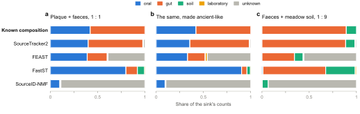
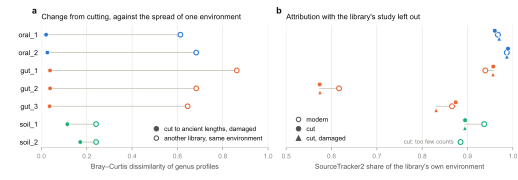
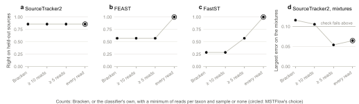
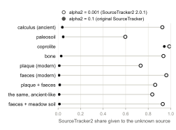

# Validation

What MSTFlow's results can be trusted for, measured on its test data. Three questions
come first: does attribution recover the composition of a sink whose sources are known,
does it name the right source for a library it has not seen, and can ancient sinks be
attributed against modern sources. The tests then decided two of MSTFlow's defaults.

Every number below comes from `-profile test`, so anyone can repeat it
([Reproducing](#reproducing)).

## The test data

Short excerpts, the first 50,000 reads, of 18 published libraries
([details](../assets/test/README.md)):

- 11 sources: oral, gut, soil and laboratory blanks, from 8 studies, modern and ancient;
- 4 ancient sinks: dental calculus, a coprolite, a paleosoil and a bone;
- 3 modern libraries from studies outside the source panel: dental plaque, faeces and
  a meadow soil;

and three sinks mixed from those three in known shares. The database holds the 274
genomes that cover the panel. It is small, which makes the test fast and the profiles
sparse: a sink holds a few dozen genera, and soils are poorly covered.

## Shares on sinks of known composition

Each mixture takes a fixed share of the read pairs of two libraries from outside the
panel, so none of its reads are among the sources. Its expected composition is each
library's environment, weighted by the counts the library brings to the table: its share
of read pairs times the counts its whole library gave.

<picture>
  <source media="(prefers-color-scheme: dark)" srcset="images/validation-mixtures-dark.svg">
  
</picture>

**Figure 1.** Estimated composition of the three mixtures, by method. SourcePredict is
left out: it reports the probability of each environment, not shares.

| Method | Plaque + faeces | The same, ancient-like | Faeces + meadow soil |
|---|--:|--:|--:|
| SourceTracker2 | 0.02 | 0.06 | 0.01 |
| FEAST | 0.39 | 0.46 | 0.56 |
| FastST | 0.46 | 0.52 | 0.23 |
| SourceID-NMF | 0.89 | 0.90 | 0.93 |

*Largest difference between estimate and known composition, over all sources.*

SourceTracker2 recovers every mixture. In the ancient-like one it leans 0.06 towards
gut: cut to ancient lengths, oral reads lose more of their classifications than gut
reads (a quarter against a sixth in the test below), so the faeces bring more of the
counts than in the modern mixture. FEAST puts 39 to 56% of each mixture in its unknown source, SourceID-NMF
about 90%, and FastST, which has no unknown source, gives the dominant one far too much.
Only SourceTracker2's estimates can be read as proportions.
`assets/test/check_mixtures.py` checks SourceTracker2 on every run of the test data and
fails beyond 0.10.

## Naming the source of an unseen library

Cross-validation holds out the sources of one study at a time, attributes them with the
remaining sources, and asks whether each method names their environment. Holding out
whole studies keeps a method from recognising a study rather than an environment.

| Method | Made a call | Right when it did | Right overall |
|---|--:|--:|--:|
| SourceTracker2 | 86% | 100% | 86% |
| FEAST | 100% | 100% | 100% |
| FastST | 100% | 100% | 100% |
| SourceID-NMF | 0% | – | 0% |
| SourcePredict | 0% | – | 0% |

*Seven held-out sources whose environment had other sources; held-out soils and blanks,
the only study of their environment, are scored separately as abstentions.*

SourceTracker2 abstained on one source and was right on the rest. FEAST and FastST name
the environment correctly even though their shares are off, so they serve as a check on
SourceTracker2's call. SourceID-NMF and SourcePredict abstain throughout; SourcePredict
needs many more sources per environment than the test data has.

## Ancient and modern libraries in one analysis

Source panels for ancient samples are mostly modern. To test whether the technical
differences between the two kinds of library bias attribution, each modern source was
made ancient-like: every read 1 cut to a length drawn from the test data's ancient
fragments (median 72 bp), and in a second version given C-to-T and G-to-A changes with
probability 0.30 × 0.55^i at i bases from either end. Both were written as read pairs
running into the adapters, so they took the ancient branch of the workflow, and each was
attributed with SourceTracker2 with its own study left out.

<picture>
  <source media="(prefers-color-scheme: dark)" srcset="images/validation-ancient-like-dark.svg">
  
</picture>

**Figure 2.** (a) How much cutting and damage changed each library's genus profile,
against how much two libraries of the same environment differ. (b) The share
SourceTracker2 gave each library's own environment, modern, cut, and cut and damaged.
The test data has one soil study, so each soil library was attributed with the other as
the only soil source.

For oral and gut libraries, cutting changed the profile 18 to 28 times less than two
libraries of one environment differ, and SourceTracker2's estimate by at most five
percentage points; damage added little. Soil, only 3 to 6% of which this database
classifies, changed more, and one cut soil library kept too few counts to be attributed
at all. What remains between an ancient sink and a modern source is mostly the biology
attribution is meant to measure.

## Choices the tests decided

**Counting.** MSTFlow counts, for each genus, the reads the classifier placed in it or
below it, and keeps every read. Bracken, which moves reads placed above the genus into
the genera present in the same sample, made the gut and soil mixture 12% soil against
24% expected: the soil's reads placed only to Proteobacteria went to Escherichia once
the faeces brought it in. A minimum of reads per taxon and sample, which Bracken also
applies at 10, does similar harm. A genus kept in a source can fall below the minimum in
a mixture of it, so the counts stop adding up, and FEAST and FastST lean on rare genera.

<picture>
  <source media="(prefers-color-scheme: dark)" srcset="images/validation-counting-dark.svg">
  
</picture>

**Figure 3.** Cross-validation (a–c) and SourceTracker2's largest error on the mixtures
(d) for four ways of counting.

**SourceTracker2's prior on the unknown source.** `--sourcetracker2_alpha2` is 0.1, the
default of the original SourceTracker, rather than the 0.001 of the SourceTracker2 2.0.1
release. With 0.001 the unknown source takes on the composition of the sink itself and
absorbs sinks that clearly match a source, modern faeces among them, and SourceTracker2
named none of the held-out sources.

<picture>
  <source media="(prefers-color-scheme: dark)" srcset="images/validation-alpha2-dark.svg">
  
</picture>

**Figure 4.** SourceTracker2's unknown share for each sink, with the two priors.

## The ancient sinks

| Sink | SourceTracker2 | FEAST | FastST | SourceID-NMF | SourcePredict |
|---|---|---|---|---|---|
| Dental calculus | oral (0.94) | oral | oral | abstains | abstains |
| Paleosoil | soil (0.94) | soil | soil | abstains | abstains |
| Bone | soil (0.96) | soil | soil | abstains | soil |
| Coprolite | abstains (unknown 0.94) | gut | laboratory | abstains | abstains |

The calculus is oral and the paleosoil soil by every method that made a call. The bone
holds too few genera to interpret (it is flagged in the sample summary) and is soil at
best. The coprolite is dominated by Methanobrevibacter, which the modern gut sources
hardly hold; SourceTracker2 puts it in the unknown source and the other methods
disagree, which is the right outcome when the panel lacks the source.

Authentication found ancient DNA damage in Arachnia in both ancient calculus libraries
(q = 0.001 and 0.017) and none in the laboratory blanks; see
[authentication](authentication.md).

## Limits

- The test data is small: 50,000 reads per library, 274 genomes, one or two studies per
  environment. It shows the workflow is right, not how well a given panel separates
  environments; cross-validation on your own panel answers that.
- The mixtures are made from three libraries. They test that shares add up and are
  recovered, not every combination of sources.
- The ancient-like libraries were cut and damaged in silico. Real ancient DNA also
  differs in what survives, which is part of the biology, not something to correct.
- KrakenUniq takes the same path as Kraken2 from the report on, but has been run on the
  test data only before Bracken was removed.

## Reproducing

```bash
nextflow run larryivan/mstflow -profile test,docker --outdir results
python3 assets/test/check_mixtures.py results
```

reproduces Figure 1, the cross-validation table and the ancient sinks. Figure 3's
alternatives were measured with the same data by earlier versions of the workflow,
before Bracken and the minimum were removed, and Figure 4's 0.001 with
`--sourcetracker2_alpha2 0.001`;
Figure 2's ancient-like libraries were made and attributed outside the workflow, as
described above. The numbers behind every figure are in [validation/](validation/), and
`python3 docs/images/make_validation_figures.py` redraws the figures from them.
